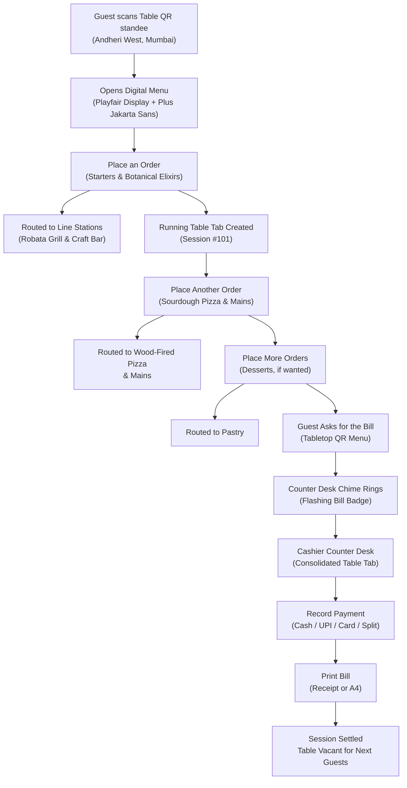

# My, Oh My — Restaurant Ordering System (Andheri West, Mumbai)
## Comprehensive Technical & Operational Architecture Guide

---

## 1. Executive Summary & Design Principles

**My, Oh My** uses a table-based ordering and counter payment workflow:
1. **Zero Online Customer Payments:** Guests **never** submit card details, UPI credentials, or OTPs on their phones.
2. **Flexible Table Ordering:** Guests scan a table QR code and can place additional orders during their visit.
3. **Running Table Tabs (`TableSession`):** Each order is added to the active dining session for that table.
4. **Pay at Counter Exclusively:** When dining is complete, guests ask for the bill via their phone or call a captain. The cashier consolidates open orders, applies discounts/taxes, and collects payment via **Cash, UPI, Card, or Multi-Tender Split**.
5. **Kitchen Decoupling:** Line chefs receive routed tickets categorized by station (`robata`, `pizza`, `mains`, `bar`, `pastry`) and advance ticket stages (`received` $\rightarrow$ `accepted` $\rightarrow$ `preparing` $\rightarrow$ `ready` $\rightarrow$ `served`) with zero access to billing records.

---

## 2. Dining Journey Workflow

---

## 3. Dedicated Modular Architecture

### 3.1 Customer Experience
- **`/menu/[token]`**: Contactless dining menu with real-time vegetarian filter, search, floating cart bar, and live **Running Table Balance** badge. Includes the **"Call Staff / Water"** modal and **"Request Final Bill & Pay at Counter"** drawer.
- **`/order/[id]`**: Order status tracker with an option to place another order.

### 3.2 Staff & Operations Modules
- **`/admin/counter` — Counter Command Desk:**
  - Table list with occupancy and open balance.
  - Selected-table order details and bill actions.
  - Multi-tender split payment modal with instant discrepancy calculation.
  - Customer bill printing in receipt or A4 format.
- **`/admin/kitchen` — Kitchen Display System (KDS):**
  - Line station filter tabs: `Robata`, `Pizza`, `Mains`, `Bar`, `Pastry`.
  - Ticket lifecycle controls with audio chime alerts.
  - Table instruction callouts and time-elapsed stamps.
- **`/admin/service` — Live Waiter Queue:**
  - Real-time queue for water bottles, cutlery, waiter calls, and counter bill requests.
- **`/admin/inventory` — 86 Item Manager:**
  - Instant stock toggles that immediately propagate to guest QR menus.
- **`/admin/tables` — QR Standee Generator:**
  - Standee artwork previews formatted for acrylic restaurant tabletop stands.
  - Direct PNG download and high-resolution print triggers.
- **`/admin/dashboard` — Shift & Operations Analytics:**
  - Daily gross F&B revenue, counter settled cash vs. UPI vs. card volume, station throughput bars, and guest favorite dishes.

---

## 4. API Reference

| Endpoint | Method | Description |
|---|---|---|
| `/api/sessions` | `GET` | Fetches active table session or all active dining sessions. |
| `/api/sessions` | `POST` | Opens a new dining session for a table. |
| `/api/sessions/[id]/bill-request` | `POST` | Guest requests bill; triggers counter chime. |
| `/api/admin/sessions/[id]/settle` | `POST` | Atomic multi-tender settlement; closes table session. |
| `/api/orders` | `GET` | Queries orders filtered by table, session, or station. |
| `/api/orders` | `POST` | Submits a new ordering round attached to the table session. |
| `/api/orders` | `PATCH` | Chef advances ticket preparation state. |
| `/api/service-requests` | `GET/POST/PATCH` | Tabletop service summons (water, waiter, cutlery). |
| `/api/menu-items` | `GET/PATCH` | Kitchen manager 86 toggle. |

---

## 5. Dining Tables

The sample setup uses **Table 1** through **Table 5**. Each table has its own QR token; names and tokens should match the restaurant's configured tables.
